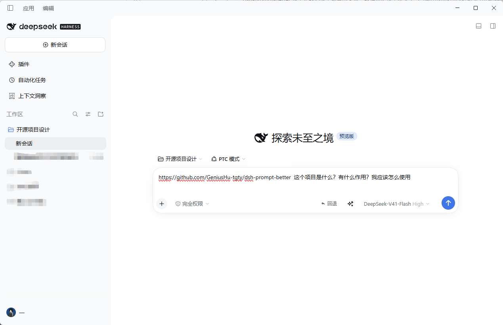
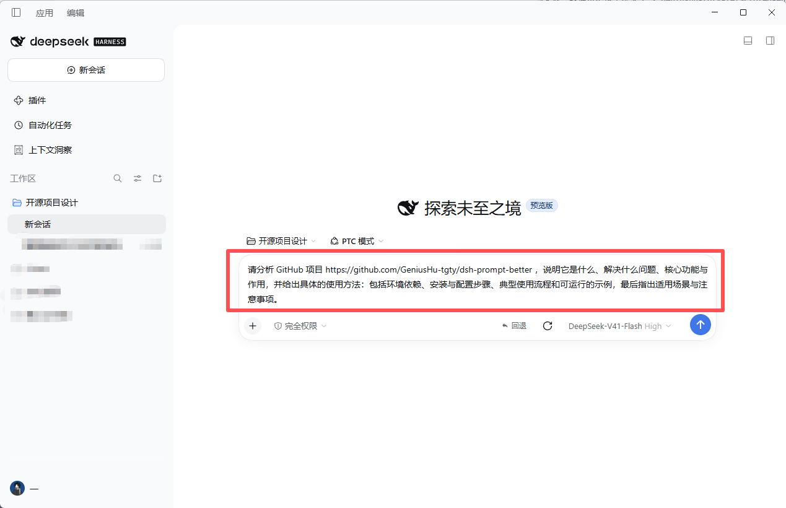

<div align="center">

# DSH Prompt Better

### ✨ One click. A clearer prompt.

Turn a rough idea into a focused prompt—right where you write. Enhance, cancel, or restore without leaving your conversation.

[](LICENSE)


**English** · [简体中文](README.zh-CN.md)

</div>

## From rough idea to ready-to-send

Ask a quick question, then enhance it into a clear request with useful context.

<table>
<tr>
<td align="center"><strong>BEFORE</strong></td>
<td align="center"><strong>AFTER</strong></td>
</tr>
<tr>
<td></td>
<td></td>
</tr>
</table>

## A simple three-state button

| ✨ Enhance |  Enhancing · click to cancel | ↺ Restore |
|:--|:--|:--|
| Rewrite your draft in place. | The animated spinner shows the request is running. | Bring back the original draft at any time after enhancement. |

The rewrite keeps your draft's language. Your text stays safe, too: if a request fails or you keep typing while it runs, the plugin won't replace it. File-reference chips are preserved.

## Uses your current DSH model

Enhancement follows the model selected for the conversation when you click ✨, using your existing DSH provider and API setup. **No separate API key or model setup is needed.** If the conversation has no model selection, the DSH host's default model is used.

## Get started

You need a working DSH installation and profile.

1. Build the package:

   ```bash
   pnpm install
   pnpm build
   ```

2. Add it to your profile's `package.json` and bundle list:

   ```json
   {
     "dependencies": {
       "dsh-prompt-better": "link:<absolute path to this package>"
     },
     "dsh": {
       "profile": {
         "bundles": ["...", "dsh-prompt-better"]
       }
     }
   }
   ```

3. Restart DSH, type a draft, and click ✨ beside the chat input.

<details>
<summary>Optional: set a timeout or pin a model</summary>

Add this to your profile's `cordis.patch.yml`. Usually, no extra configuration is needed.

```yaml
- id: enhance-prompt
  name: dsh-prompt-better
  config:
    timeoutMs: 120000
    # Optional: use a fixed model instead of the conversation's selection.
    # provider: deepseek-account
    # model: deepseek-flash
```

</details>

<details>
<summary>Development</summary>

```bash
pnpm install
pnpm build
pnpm typecheck
```

</details>

---

<div align="center">

[Apache-2.0 License](LICENSE) · [简体中文](README.zh-CN.md)

</div>
